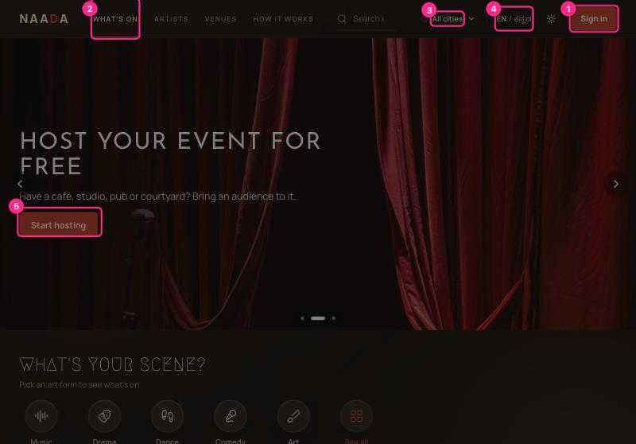
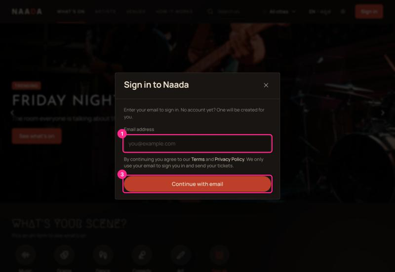
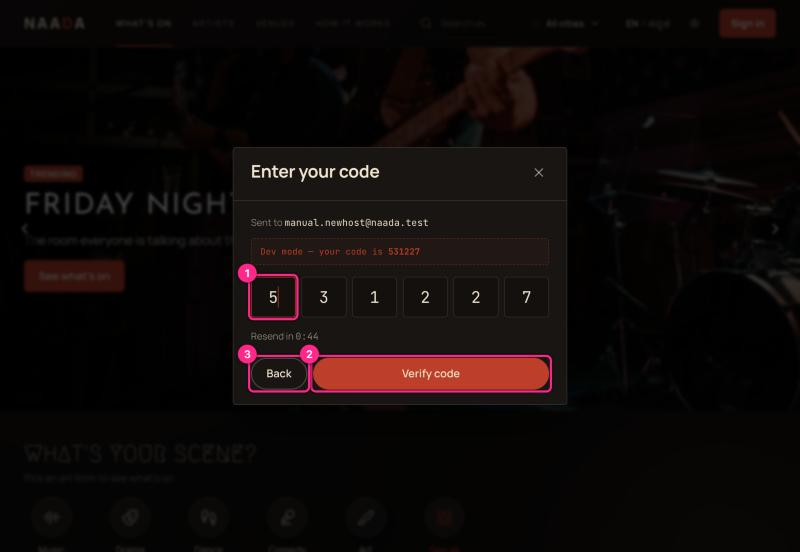
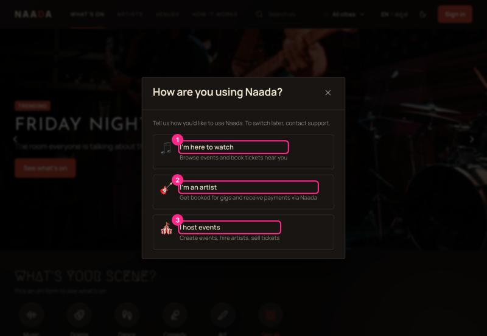
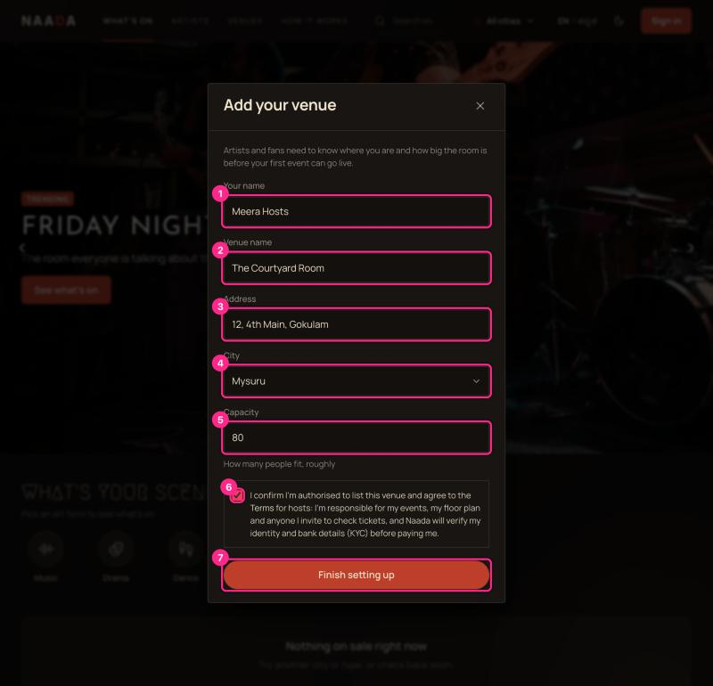

# 00 · Sign in, sign up and choosing a role

Naada has no passwords. You enter your email, we send a six-digit code, and the code signs you in.
If the email is new, the same steps create your account — there is no separate "Sign up".

**Who:** everyone. **Time:** about 1 minute.

## Where is "Sign in"?

On inner pages (What's on, Artists, Venues…) there is a **Sign in** button at the top right.

| # | What you're looking at |
|---|---|
| 1 | **Sign in** — opens the email box. |
| 2 | **What's on** — the main list of events. |
| 3 | **City** — "All cities", or pick Mysuru / Bengaluru. |
| 4 | **Language** — EN / ಕನ್ನಡ. (Only the browse pages are translated today.) |
| 5 | **Start hosting** — the hero banner's call to action for venue owners; it also opens sign-in. |

> ⚠ **Heads-up:** the very first landing page (`/`) for a signed-out visitor shows *Browse events* and *Host your event for free* but **no Sign in**. Returning users have to click *Browse events* first. See UX-AUDIT **M1**.

## Step 1 — Enter your email

| # | What you're looking at |
|---|---|
| 1 | **Email address** — use an address you can open. It is your login forever and cannot be changed in Settings. |
| 3 | **Continue with email** — sends the code. |

Between the two, a notice reads *"By continuing you agree to our Terms and Privacy Policy. We only use your email to sign you in and send your tickets."* Both links open in a new tab so you don't lose what you typed. Your agreement is recorded with the date and document version ([10](10-privacy-cookies-and-deleting-your-account.md)).

## Step 2 — Enter the six-digit code

| # | What you're looking at |
|---|---|
| 1 | **Code boxes** — type or paste the six digits. In the dev build the code is also printed in the red strip above the boxes (this will not exist in production). |
| 2 | **Verify code** — signs you in. |
| 3 | **Back** — fix a mistyped email. |

The code expires in 10 minutes. "Resend in 0:47" counts down before you can ask for another.

## Step 3 — Tell Naada how you'll use it (new accounts only)

| # | Choice | What happens next |
|---|---|---|
| 1 | **I'm here to watch** | You land on the public site. Nothing else to set up. |
| 2 | **I'm an artist** | An artist profile is created; you land in the artist console. |
| 3 | **I host events** | A short "Add your venue" form opens (next screen), then the host console. |

> **Heads-up:** there is no self-service way to switch role later — the sheet says *"To switch later, contact support."* (It used to promise a Settings option that doesn't exist; UX-AUDIT **H9**.) Pick carefully.

## Step 4 — Hosts only: add your venue

| # | Field | Notes |
|---|---|---|
| 1 | **Your name** | Shown on your dashboard greeting. |
| 2 | **Venue name** | Public. Guests see it on event pages. |
| 3 | **Address** | Street address. |
| 4 | **City** | Mysuru, Bengaluru (or Mysuru Demo in the test data). |
| 5 | **Capacity** | Rough headcount. |
| 6 | **Agreement checkbox** | Required and unticked: you confirm you're authorised to list the venue and accept the hosts' Terms (responsibility for events, floor plan and anyone you invite; identity and bank checks before payout). |
| 7 | **Finish setting up** | Disabled until every field and the checkbox are filled. Creates the venue and opens `/host`. |

> ⚠ **Heads-up:** this is the **only** place a venue can be created. If you close the form without finishing, there is currently no way to add a venue later (UX-AUDIT **B2**). Finish it in one go.

## Signing out and your account menu

Click your round initial at the top right. The menu has **My tickets**, **Gate duty** (if you were invited to check tickets), **Saved**, **Settings** and **Sign out**. Hosts, artists and admins also see a link to their console.

## Troubleshooting

| Problem | Fix |
|---|---|
| "I didn't get the code" | Check spam; wait for the 0:00 timer, then **Resend**. After several tries Naada slows requests down on purpose. |
| "Wrong code" | Codes lock after repeated wrong guesses; request a new one. |
| "I picked the wrong role" | Contact support — see ⚠ above. |
