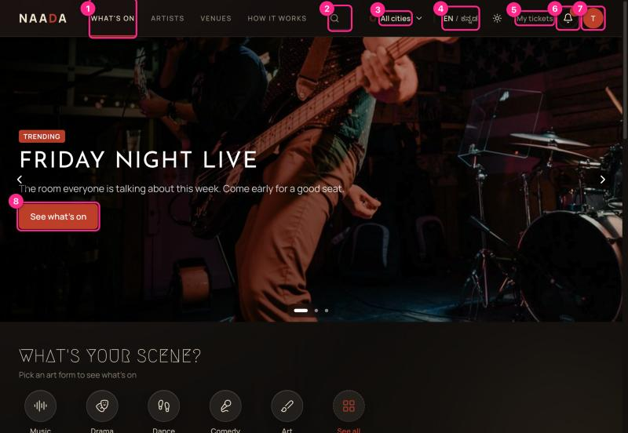
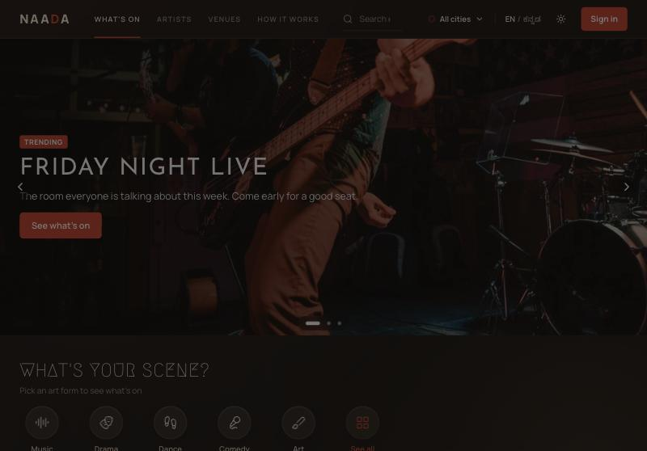
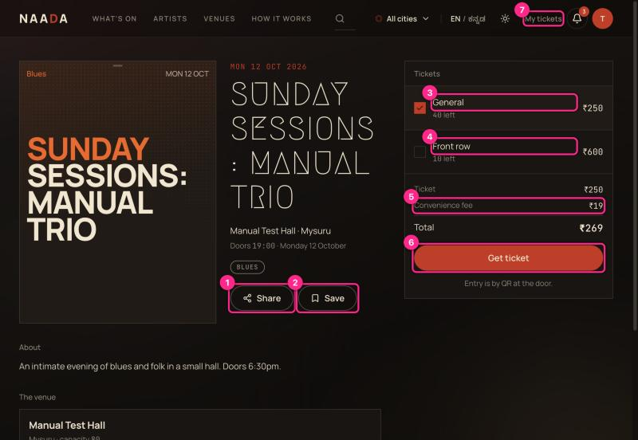
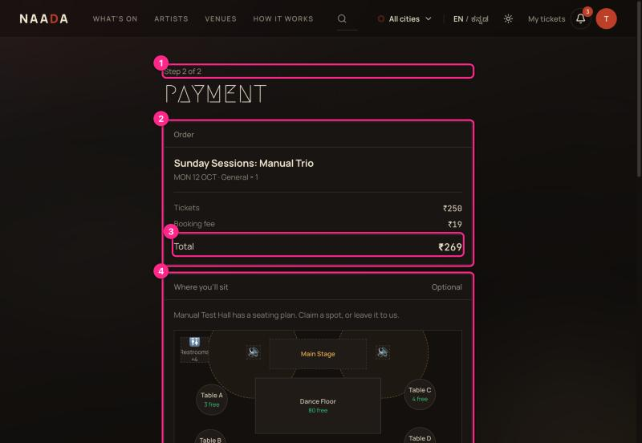
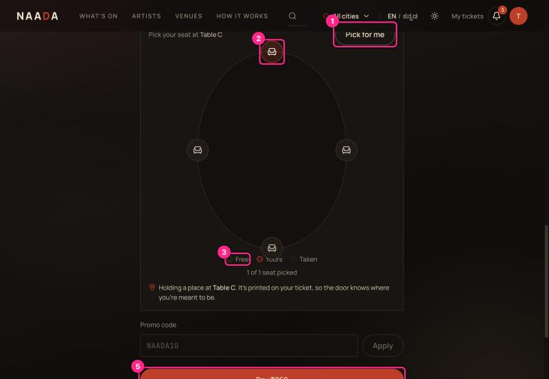
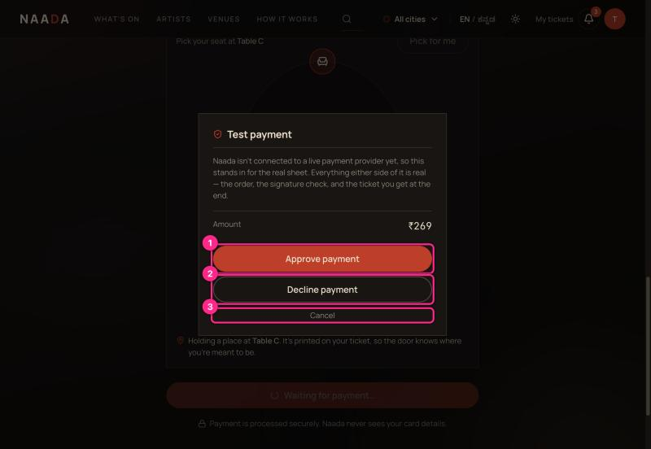
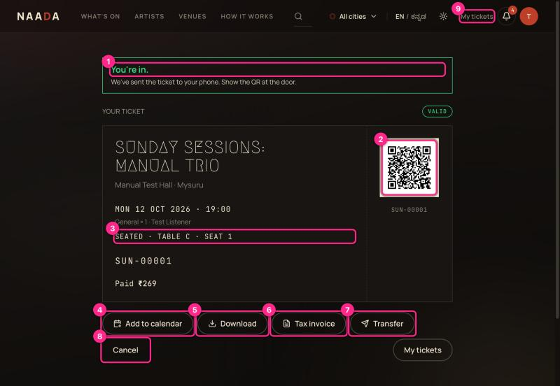
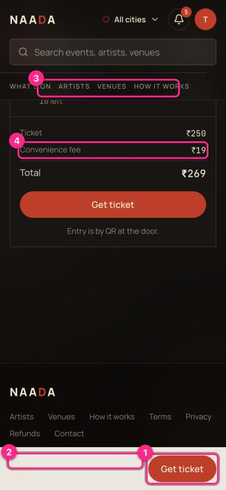

# 01 · Find an event and book a ticket

**Who:** guests (audience). **Time:** about 2 minutes. **You need:** a Showzy account (see [00](00-getting-started-sign-in-and-roles.md)).

## Step 1 — Find something on

Open **What's on** from the top bar. When you are signed in, the home page is the same list.

| # | What you're looking at |
|---|---|
| 1 | **What's on** — the event list. Scroll for art-form shortcuts (Music, Drama, Dance, Comedy, Art), recommended events, artists and venues. |
| 2 | **Search** — events, artists and venues. |
| 3 | **City** — narrow the list. |
| 4 | **Language** — EN / ಕನ್ನಡ. |
| 5 | **My tickets** — jump to your tickets any time. |
| 6 | **Notifications** — red dot = something new (booking confirmations, gate invites). |
| 7 | **Account menu** — tickets, saved, settings, sign out. |
| 8 | **Hero button** — the big banner rotates between audience, artist and host messages. |

> ⚠ If nothing is on sale you'll see *"Nothing on sale right now"* with no next step, while the banner above still says **TRENDING** (UX-AUDIT **M1**). Try another city, or follow artists.

## Step 2 — Open the event and choose a ticket

| # | What you're looking at |
|---|---|
| 1 | **Share** — copies a link you can send on WhatsApp. |
| 2 | **Save** — bookmarks the event under *Saved*. |
| 3 | **Ticket tier (General)** — tick one. Shows how many are left and the price. |
| 4 | **Another tier (Front row)** — switching tiers updates the total. |
| 5 | **Convenience fee** — a flat fee added to each ticket; the total below it is exactly what you will pay. |
| 6 | **Get ticket** — goes to payment (or asks you to sign in first). |
| 7 | **My tickets** |

> ⚠ **Heads-up:** you can buy **one ticket per checkout**. There is no quantity control anywhere (UX-AUDIT **H11**). Friends who want to sit together currently have to check out separately.

> ⚠ "Doors 19:00" on the page is really the **start time**. The event form has no separate doors time (UX-AUDIT **M10**).

## Step 3 — Review the order and pick where to sit

If the venue has drawn a floor plan, the payment page includes **Where you'll sit** (optional).

| # | What you're looking at |
|---|---|
| 1 | **Step 2 of 2** — you are on the payment step. (Signed-in guests skip the details step, so you never see "Step 1".) |
| 2 | **Order** — event, date, tier, quantity. |
| 3 | **Total** — tickets + booking fee. This is what you'll be charged. |
| 4 | **Where you'll sit** — the venue's plan: stage at the top, tables, dance floor, 🚻 restrooms and 🔊 speakers (dashed rings = loudest areas). |

Choose an area from the plan or from the list underneath (a table, the dance floor, VIP…). Areas near a speaker are labelled *"Close to a speaker — lively, louder"*; tables that offer baby chairs say so.

### Pick your seat at a table

When you choose a table that has individual chairs, a seat map appears **below the list** (scroll down — it does not jump into view, UX-AUDIT **M3**).

| # | What you're looking at |
|---|---|
| 1 | **Pick for me** — fills the first free seats automatically. |
| 2 | **Your seat** — tap a chair to select it (pink ring = yours; greyed = taken). Tap again to deselect. |
| 3 | **Legend** — Free / Yours / Taken. |
| 5 | **Pay** — enabled only once you have picked a seat for every ticket. |

If the table offers **baby chairs**, a *"Bringing a little one?"* stepper (+/−) appears under the map. Baby chairs are free and are held with your order.

You can also skip seating entirely: **No preference** — "we'll seat you on the night".

## Step 4 — Pay

Click **Pay ₹…**. In the dev build a **Test payment** sheet stands in for the real payment provider.

| # | What you're looking at |
|---|---|
| 1 | **Approve payment** — completes the order. |
| 2 | **Decline payment** — shows the failed-payment path. |
| 3 | **Cancel** — close the sheet; your seats stay held for 15 minutes. |

> **Tip:** your seats are held for **15 minutes** while you pay. If time runs out they are released automatically.

## Step 5 — Your ticket

| # | What you're looking at |
|---|---|
| 1 | **"You're in."** — confirmation. |
| 2 | **QR code** — show this at the door. |
| 3 | **Seat line** — e.g. *SEATED · TABLE C · SEAT 1*; the door team sees the same. |
| 4 | **Add to calendar** — downloads an .ics file. |
| 5 | **Download** — saves the ticket. |
| 6 | **Tax invoice** — GST invoice for the order. |
| 7 | **Transfer** — give the ticket to a friend ([02](02-guest-tickets-and-account.md)). |
| 8 | **Cancel** — cancel and refund ([02](02-guest-tickets-and-account.md)). |
| 9 | **My tickets** — all your tickets. |

> ⚠ The banner says *"We've sent the ticket to your phone."* Showzy does not collect a phone number at checkout or send SMS. Your ticket is in **My tickets** and by email (UX-AUDIT **H8**).

## On a phone

| # | What you're looking at |
|---|---|
| 1 | **Sticky Get ticket** — always at the bottom of the screen. |
| 2 | **Sticky price** — the price on the bar is very faint (UX-AUDIT **M5**). |
| 3 | **Section links** scroll sideways. |
| 4 | **Fee line** — same as desktop. |

The poster fills the first screen on a phone; scroll to reach the tiers.

## If something goes wrong

| Message | What to do |
|---|---|
| *Only N places left in Table A* / *fully booked* | Someone took it while you were choosing. Pick another table; availability reloads automatically. |
| *One of those seats has just been taken — pick again* | Choose different seats. |
| Payment declined | Nothing is charged; the seats are released. Try again. |
| *Pick a seat for each ticket* | The seat map needs a seat per ticket before **Pay** works. |
