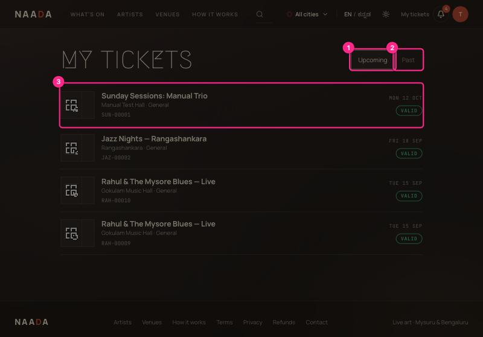
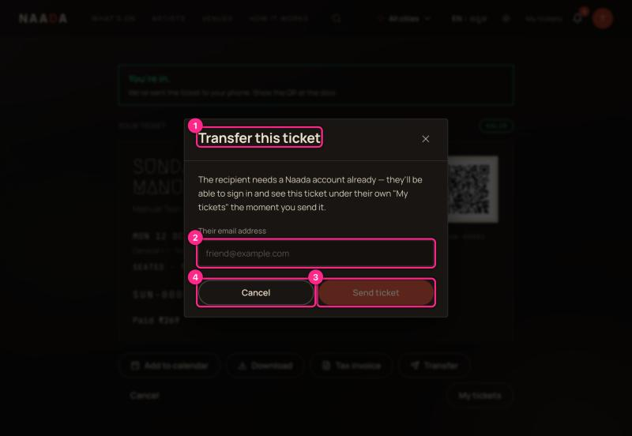
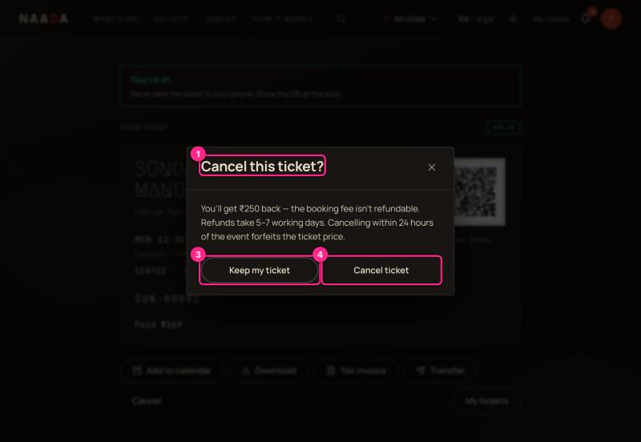
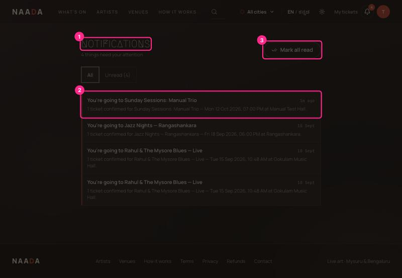
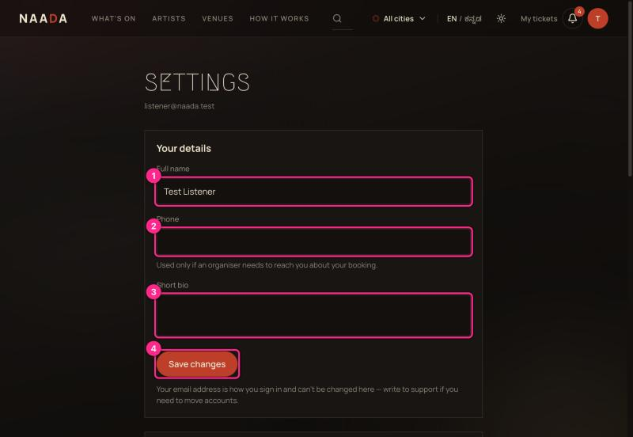

# 02 · My tickets, transfer, cancel, notifications and settings

**Who:** guests. **You need:** to be signed in.

## My tickets

Open **My tickets** from the top bar or account menu.

| # | What you're looking at |
|---|---|
| 1 | **Upcoming** — events still to come. |
| 2 | **Past** — events you've been to. |
| 3 | **A ticket** — name, venue, tier, ticket number, date and a green **VALID** pill. Click it to open the QR. |

> ⚠ **Heads-up:** *Upcoming* decides by the event's **status**, not its date. Events whose date has gone can still show as upcoming and valid until Showzy marks them completed (UX-AUDIT **H10**). Check the date on the row.

## Transfer a ticket to a friend

Open the ticket → **Transfer**.

| # | What you're looking at |
|---|---|
| 1 | **Transfer this ticket** |
| 2 | **Their email address** — they must *already have a Showzy account*. The ticket appears under their *My tickets* immediately. |
| 3 | **Send ticket** — enabled once the email is filled in. |
| 4 | **Cancel** — close without sending. |

**Heads-up:** after a transfer the ticket leaves your account and your QR stops working for you. The seat label moves with it.

## Cancel a ticket and get a refund

Open the ticket → **Cancel** (bottom left).

| # | What you're looking at |
|---|---|
| 1 | **Cancel this ticket?** — states the money outcome up front. |
| 3 | **Keep my ticket** — the safe choice, on the left. |
| 4 | **Cancel ticket** — confirms. |

The refund is the ticket price only; the booking fee is not refundable. Refunds take 5–7 working days. **Cancelling within 24 hours of the event forfeits the ticket price** — the dialog tells you if this applies to you.

## Notifications

The bell shows unread items. Open it for the full page.

| # | What you're looking at |
|---|---|
| 1 | **Notifications** — count of unread. |
| 2 | **An item** — booking confirmations ("You're going to…"), gate invites, refunds. |
| 3 | **Mark all read** |

## Settings

| # | What you're looking at |
|---|---|
| 1 | **Full name** — printed on your tickets. |
| 2 | **Phone** — optional; used only if an organiser needs to reach you about a booking. If someone invites you to a gate team *by phone number*, it must match this. |
| 3 | **Short bio** — optional. |
| 4 | **Save changes** |

Further down: **Language**, **Email notifications** (ticket confirmations, reminders, artists you follow, city round-up — marketing is off by default and every change is recorded), **Privacy & consent**, **Download my data**, **Sign out**, and **Delete account**. Those last privacy controls — and the guided, code-confirmed deletion process — are covered step by step in [10 · Privacy, cookies and deleting your account](10-privacy-cookies-and-deleting-your-account.md).

## Saved events

The **Save** button on an event page bookmarks it; find them at **Saved** in the account menu.
