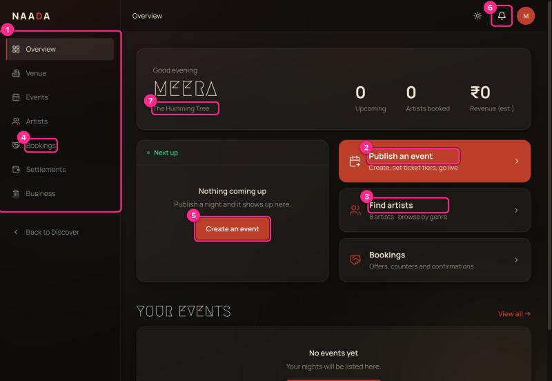
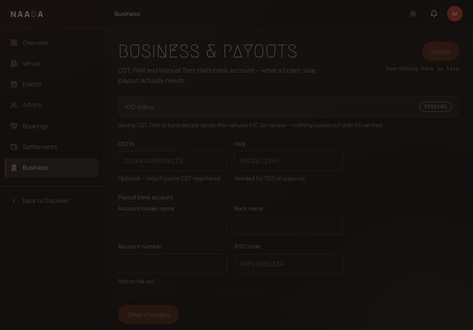
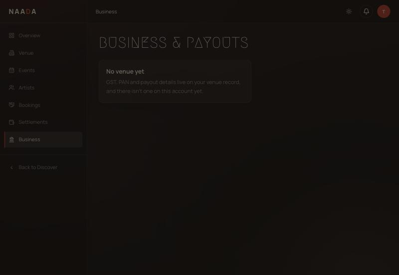

# 03 · Host: set up your venue and business details

**Who:** venue owners / hosts. **Time:** 10 minutes. **You need:** a host account with a venue ([00](00-getting-started-sign-in-and-roles.md), step 4).

## Your dashboard

After onboarding you land on **Overview** (`/host`).

| # | What you're looking at |
|---|---|
| 1 | **Sidebar** — Overview, Venue (floor plan), Events, Artists, Bookings, Settlements, Business. |
| 2 | **Publish an event** — the main call to action; starts a new event. |
| 3 | **Find artists** — search artists and send a brief. |
| 4 | **Bookings** — offers and confirmations with artists. |
| 5 | **Create an event** — the same action, inside the empty "Next up" card. |
| 6 | **Notifications bell** |
| 7 | **Line under your name** — should show your venue; see the warning below. |

The three numbers at the top are **Upcoming** events, **Artists booked** and **Revenue (est.)**.

> ⚠ **Heads-up:** right after onboarding, line 7 can read **"The Humming Tree"** (a demo name) instead of your venue; it corrects itself after a refresh (UX-AUDIT **H2**).
>
> ⚠ The dashboard has **no setup checklist**. The things you must finish before you can sell — business details, a floor plan if you want seating, ticket tiers, publishing — are not listed anywhere. Use this chapter as your checklist:
>
> 1. ☐ Business & payouts (this page) 2. ☐ Floor plan ([04](04-host-floor-plan-designer.md)) 3. ☐ Create event ([05](05-host-create-and-publish-an-event.md)) 4. ☐ Gate team ([06](06-host-gate-team-and-live-check-in.md))

## Business & payouts (KYC)

Sidebar → **Business**.

What's on the page:

- **KYC status** pill — starts at **PENDING**. Saving GST, PAN or bank details sends the venue for review by a Showzy admin ([09](09-admin-guide.md)). Nothing is paid out until it's verified.
- **GSTIN** (optional — only if GST-registered) and **PAN** (needed for TDS on payouts).
- **Payout bank account** — holder name, bank name, account number, IFSC. The account number is write-only: after saving, only the last 4 digits are ever shown again.
- **Save changes**.

> ⚠ Business is the *only* place to edit venue details, and it only edits compliance fields. **Venue name, address, photos and description cannot be edited in the app** after onboarding (UX-AUDIT **B2**).
>
> ⚠ Also: the button reads **"Saved · Everything here is live"** as soon as the page opens, before you've changed anything (UX-AUDIT **M12**).

### What KYC does and doesn't block

- KYC status **does not stop you selling tickets** today; it gates payouts.
- Venue payouts for ticket sales are not shown in Settlements yet (UX-AUDIT **H3**).

## Dead end to avoid: "No venue yet"

If you ever see **No venue yet** on the Business page, or *"You don't have a venue yet, so this plan can only be kept in this browser"* on the floor-plan page, your account has no venue and the app offers **no button to add one** (UX-AUDIT **B2**). Ask support to attach a venue.

