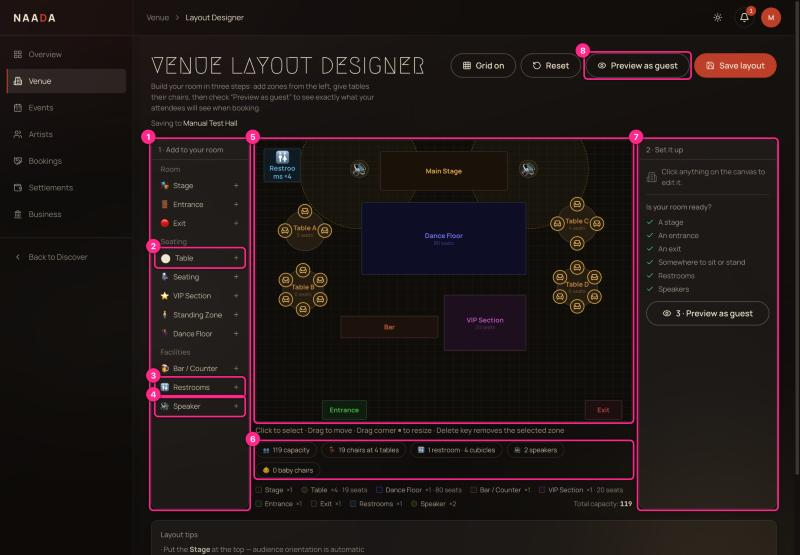
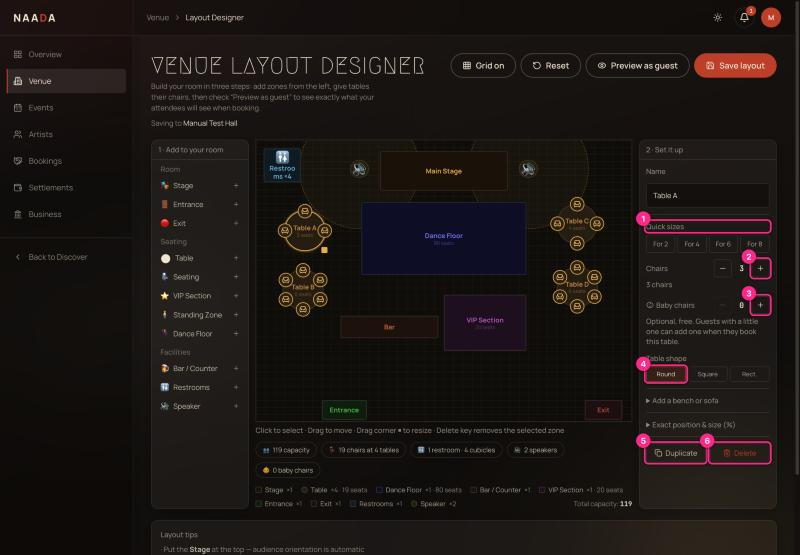
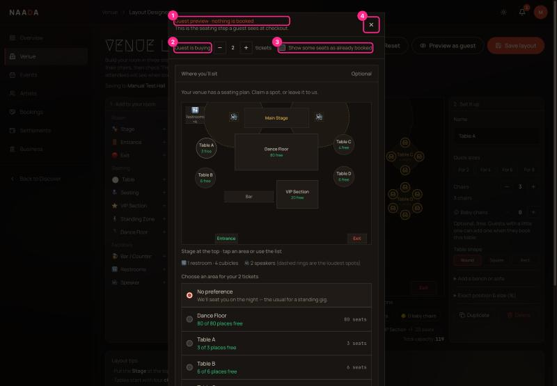

# 04 · Host: floor-plan designer and guest preview

**Who:** hosts. **Time:** 10–20 minutes. Sidebar → **Venue**. Works best on a laptop (screen at least ~1200 px wide).

Guests see this plan when they book, can claim a table seat by seat, and see where the restrooms and speakers are.

| # | What you're looking at |
|---|---|
| 1 | **1 · Add to your room** — grouped palette: **Room** (Stage, Entrance, Exit), **Seating** (Table, Seating, VIP, Standing, Dance floor), **Facilities** (Bar, Restrooms, Speaker). Click an item to drop it in the middle of the canvas. |
| 2 | **Table** — adds a round table with **4 chairs**. |
| 3 | **Restrooms** — a non-bookable marker with a cubicle count (guests see "🚻 1 restroom · 4 cubicles"). |
| 4 | **Speaker** — a non-bookable marker. A dashed ring shows how far the sound carries; tables inside it are labelled *"Close to a speaker"* for guests. |
| 5 | **Canvas** — drag to move, drag the corner square to resize, click empty space to deselect, **Delete** removes the selected item. Changes **save automatically**. |
| 6 | **Summary chips** — capacity, chairs at N tables, restrooms/cubicles, speakers, baby chairs. |
| 7 | **2 · Set it up** — properties of the selected item. When nothing is selected it shows **Is your room ready?** (stage, entrance, exit, somewhere to sit, restrooms, speakers) with one-click **Add** for anything missing. |
| 8 | **Preview as guest** — see exactly what guests see (below). |

> ⚠ **Heads-up:** a brand-new venue opens with a **ready-made sample room** (stage, four tables, VIP, speakers…), already ticked green and **auto-saved**. Guests will see this plan unless you change it (UX-AUDIT **H1**). Delete or rebuild everything that isn't your room.

## Give a table its chairs

Click a table to select it.

| # | What you're looking at |
|---|---|
| 1 | **Quick sizes** — *For 2 / 4 / 6 / 8* sets the chair count in one tap. |
| 2 | **Chairs +/−** — adds or removes one chair; chairs re-space evenly. Each chair is booked individually by guests. |
| 3 | **Baby chairs +/−** — optional free high chairs (0–8) guests can add when booking this table. Shown on the canvas as 👶 ×N. |
| 4 | **Table shape** — Round, Square, Rect. |
| 5 | **Duplicate** — copies the table (with new seat ids) a little to the side. |
| 6 | **Delete** |

Under **Add a bench or sofa** you can add 2–6 connected seats along a side; **Exact position & size** lets you type percentages.

> **Tip:** to remove a single chair, select the table first, then click the chair. (Clicking a chair on an unselected table only selects the table, so you can't remove one by accident.)

## Preview as guest

Click **Preview as guest** (or the button in the right panel).

| # | What you're looking at |
|---|---|
| 1 | **"Guest preview · nothing is booked"** — nothing you click here creates a booking. |
| 2 | **Guest is buying N tickets** — change the number to test the seat picking for groups. |
| 3 | **Show some seats as already booked** — see the "taken" look. |
| 4 | **Close** (or press **Esc**, or **Back to editing** at the bottom). |

The preview runs the *real* guest screen against your draft, so what you see is what guests get.

## Checklist before you publish

- [ ] No sample furniture left that isn't yours.
- [ ] A **stage** at the top (guests assume the stage is "up").
- [ ] An **entrance** and an **exit**.
- [ ] Every seated table has the right number of chairs (and baby chairs if you want them).
- [ ] Restrooms and speakers are marked.
- [ ] You used **Preview as guest** with 1 and 4 tickets.

## Good to know

- Standing areas (dance floor, standing zone) and VIP are booked by **quantity**: capacity = how many places you'll sell. Tables with chairs are booked **by seat**.
- A zone with capacity 0 is not bookable.
- Stage, entrance, exit, restrooms and speakers are never bookable, whatever capacity you type.
- If the screen is narrow, the three columns stack and tables overlap — use a bigger window (UX-AUDIT **M6**).
