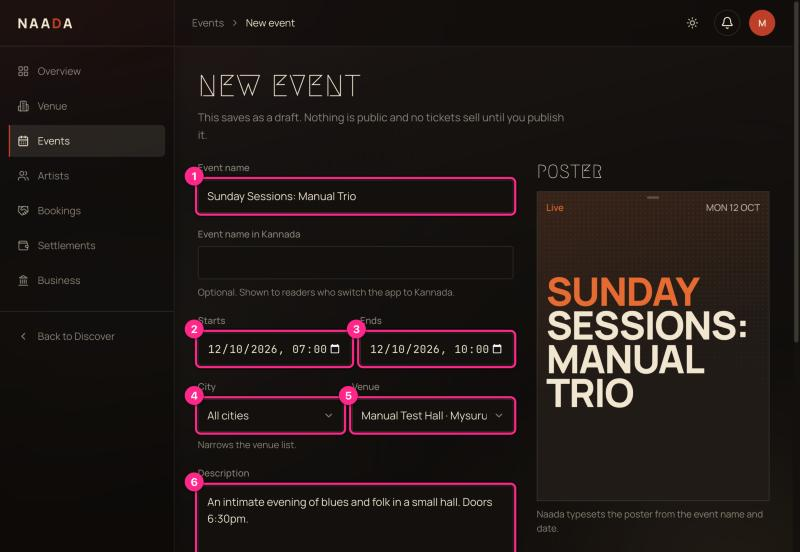
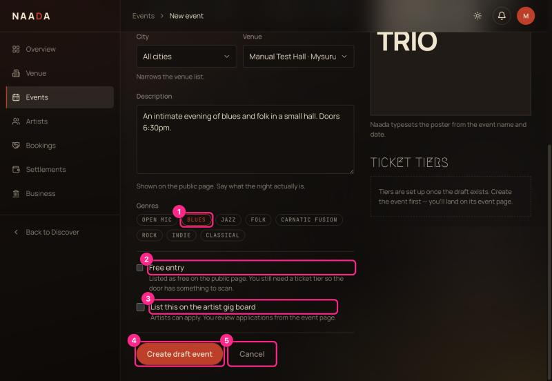
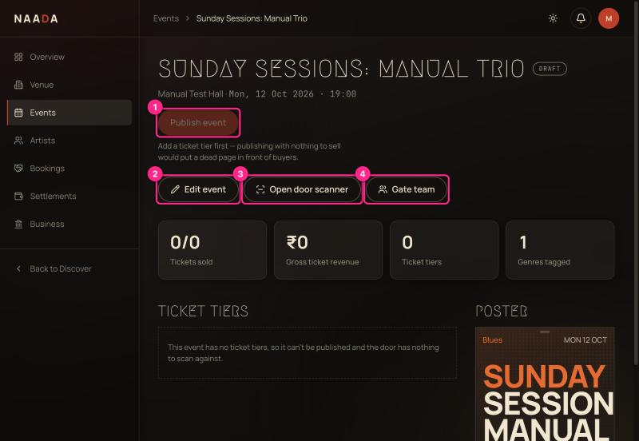
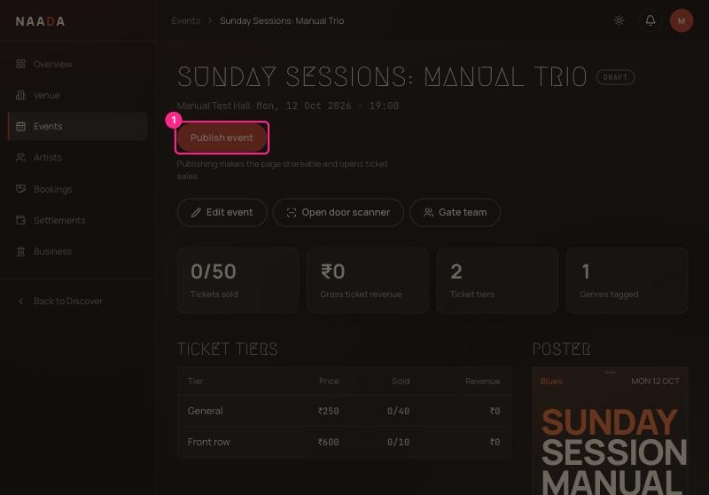
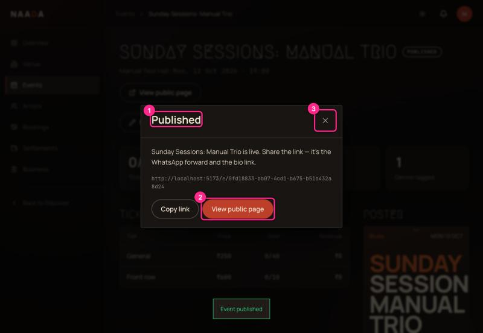

# 05 · Host: create, publish and share an event

**Who:** hosts. **Time:** 5 minutes (once tiers are set — see the blocker below).

> 🛑 **Blocker today:** the app has **no screen or button to add ticket tiers** (General, VIP…). An event cannot be published without at least one. Until tier management ships, tiers have to be added by Naada staff (UX-AUDIT **B1**). Everything else in this chapter works as shown.

## Step 1 — Start a new event

Dashboard → **Publish an event** (or sidebar **Events** → open an existing one). The new-event form saves as a **draft**: nothing is public and no tickets sell until you publish.

| # | Field | Notes |
|---|---|---|
| 1 | **Event name** | The poster on the right is typeset live from the name and date. A Kannada name is optional (shown when a guest switches to Kannada). |
| 2 | **Starts** | Date and time. This is also what guests see as "Doors". |
| 3 | **Ends** | Gatekeeper access runs until 4 hours after this. |
| 4 | **City** | Narrows the venue list. |
| 5 | **Venue** | Choose yours. The list currently includes every venue on Naada. |
| 6 | **Description** | Shown on the public page — say what the night actually is. |

> ⚠ **Heads-up:** choosing a **City** can empty the Venue list ("No venues in this city yet"), even when venues exist. Leave City on **All cities** and pick the venue directly (UX-AUDIT **B3**).

| # | What you're looking at |
|---|---|
| 1 | **Genres** — tap to tag (used for browsing). |
| 2 | **Free entry** — lists the event as free. You still need a ticket tier so the door has something to scan. |
| 3 | **List on the artist gig board** — lets artists apply; you review applications from the event page. |
| 4 | **Create draft event** |
| 5 | **Cancel** |

## Step 2 — The event page (draft)

| # | What you're looking at |
|---|---|
| 1 | **Publish event** — greyed out until the event has a ticket tier ("Add a ticket tier first…"). |
| 2 | **Edit event** — change details (changes save automatically). |
| 3 | **Open door scanner** — check people in yourself ([06](06-host-gate-team-and-live-check-in.md)). |
| 4 | **Gate team** — invite people to scan for you ([06](06-host-gate-team-and-live-check-in.md)). |

Below: tiles for **Tickets sold**, **Gross ticket revenue**, **Ticket tiers**, **Genres tagged**, then the **Ticket tiers** table and the poster.

## Step 3 — Publish

When the event has tiers, **Publish event** turns active.

Click **Publish event**. A confirmation appears with the public link.

| # | What you're looking at |
|---|---|
| 1 | **Published** — the event is live and tickets can be bought. |
| 2 | **View public page** — opens what guests see. |
| 3 | **Close** |

**Copy link** is the quickest way to share it — paste it into WhatsApp or your bio.

## After publishing

- The event page shows **Tickets sold**, **Gross ticket revenue** and per-tier sales as guests buy.
- You can still edit details; guests see changes straight away.
- Seating comes from your floor plan ([04](04-host-floor-plan-designer.md)).

> ⚠ The **Events** list card can show stale numbers (e.g. *0/49 ₹0* while the event page correctly says *1/50 ₹250*), and the Events page has no *New event* button — use the dashboard (UX-AUDIT **H5**, **H6**).

## There's no "cancel event" or refund-all button yet

If you must cancel a night, contact Naada support so guests can be refunded and notified.
