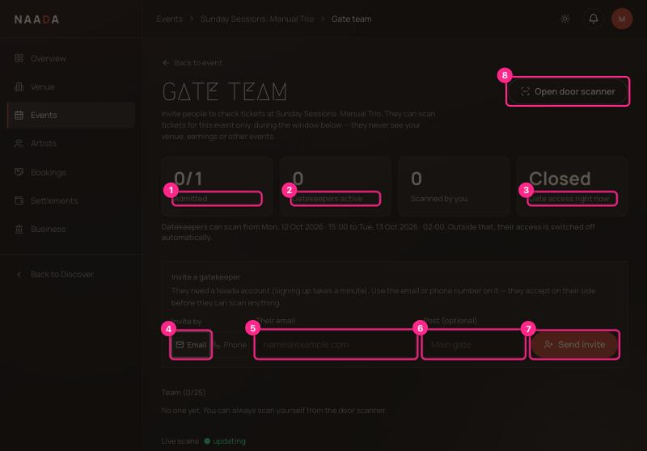
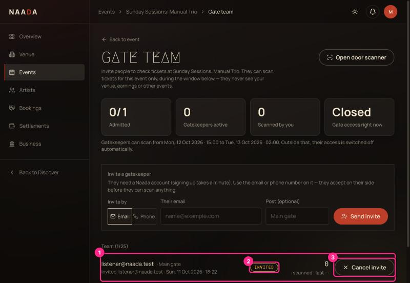
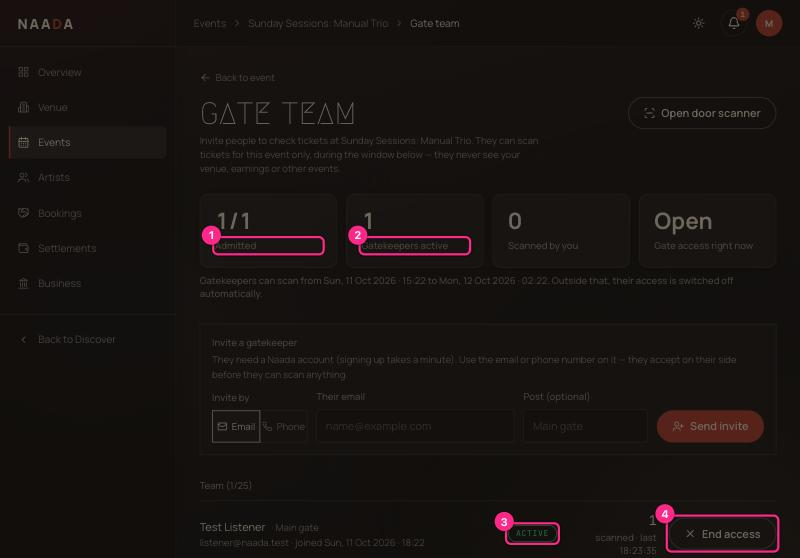
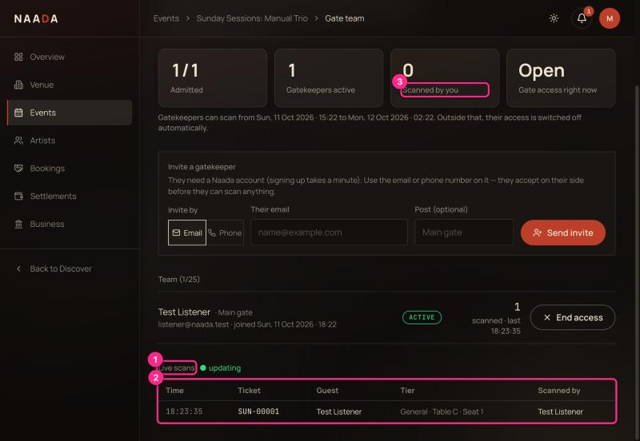

# 06 · Host: gate team and live check-in

Hand the door to people you trust — without giving them your venue, money or other events.

**Who:** the host who organises the event. **Time:** 2 minutes to invite; then it's live.

## How it works

1. You **invite** someone by email or phone, for **one event**.
2. They sign in with their own Naada account and **accept** ([07](07-gatekeeper-guide.md)).
3. From **4 hours before the event starts until 4 hours after it ends** they can scan tickets and search the guest list. Outside that window, or on any other event, they can do nothing.
4. You watch every scan **live**, and can end anyone's access instantly.

A gatekeeper is just an ordinary Naada account. They don't get a host console and can't see ticket buyers' emails or phones.

## Open the Gate team

Event page → **Gate team**.

| # | What you're looking at |
|---|---|
| 1 | **Admitted** — people checked in / tickets sold. |
| 2 | **Gatekeepers active** — people who have accepted and can scan now or later. |
| 3 | **Gate access right now** — **Open** or **Closed** for gatekeepers (you can always scan). |
| 4 | **Invite by Email / Phone** — pick how you'll name them. |
| 5 | **Their email** (or phone number). Use exactly the email or number on *their* Naada account. |
| 6 | **Post (optional)** — e.g. "Main gate". |
| 7 | **Send invite** |
| 8 | **Open door scanner** — scan yourself. |

The line under the tiles tells you the exact window gatekeepers can scan.

## Send an invite

Enter the email, optionally a post, then **Send invite**.

| # | What you're looking at |
|---|---|
| 1 | **The new member** — shows what you typed until they accept. |
| 2 | **INVITED** — waiting for them. Turns **ACTIVE** when they accept. |
| 3 | **Cancel invite** — withdraws it. For active members the button reads **End access**. |

- If the person **already has an account**, they get an in-app notification and see the invite under **Gate duty**.
- If they **don't have one yet**, the invite waits for them. **Naada does not email them**, so tell them yourself to sign up with that email or phone number (UX-AUDIT **M7**).
- Limits: one invite per person per event; up to 25 people per event; you can't invite yourself.

## Watch the door live

Keep this page open during the event. It refreshes every few seconds.

| # | What you're looking at |
|---|---|
| 1 | **Admitted** — climbs as guests are checked in. |
| 2 | **Gatekeepers active** |
| 3 | **ACTIVE** — the person accepted. Their name and email show under the row. |
| 4 | **End access** — cuts them off on their very next scan. |

Each person's row also shows **how many they've scanned** and **when they last scanned**.

| # | What you're looking at |
|---|---|
| 1 | **Live scans** — "updating" means it's refreshing. |
| 2 | **Scan log** — time, ticket number, guest, tier and seat, and **who scanned**. Newest first, last 40. |
| 3 | **Scanned by you** — your own count. |

## Use the scanner yourself

**Open door scanner** is the same screen gatekeepers use ([07](07-gatekeeper-guide.md)). Your scans count under "Scanned by you".

## Ending access

**End access** (or **Cancel invite**) is immediate. The person's phone may still show the scanner, but their next scan is refused with a clear message.

## Troubleshooting

| Problem | Fix |
|---|---|
| "Invite doesn't show for them" | They are signed in with a different email, or the number isn't saved in their Settings. |
| "Gate access: Closed" | You're outside the window (more than 4h before start or 4h after end). It opens automatically. |
| "That person is already invited" | Each person can be invited once per event. Cancel the old invite first. |
