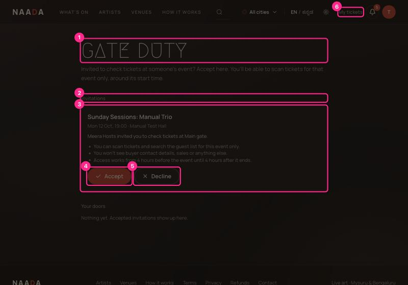
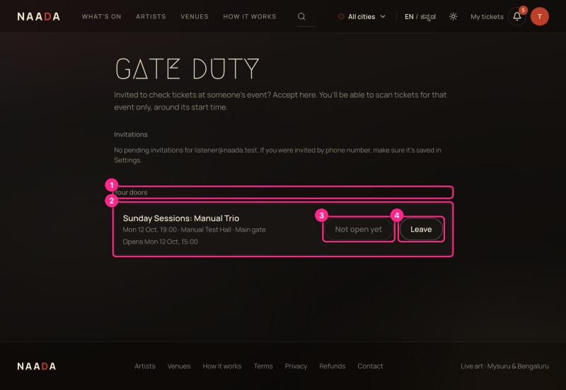
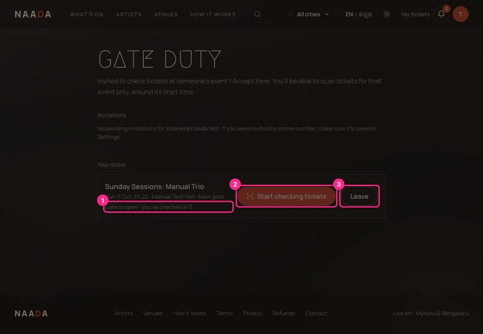
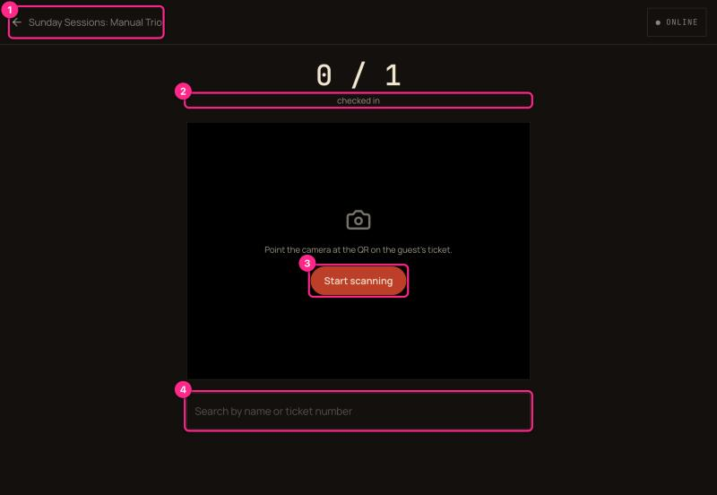
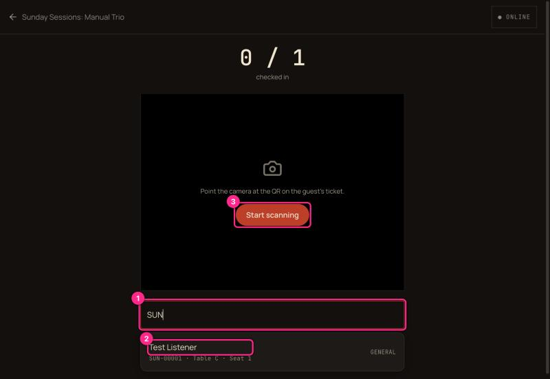

# 07 · Gatekeeper: accept an invite and check tickets

You've been asked to check tickets at someone's event. You don't need a special account — just your normal Naada account.

**What you can do:** scan tickets and look up guests for **that one event**, from 4 hours before it starts until 4 hours after it ends.
**What you can't do:** see buyers' emails or phones, sales, money, the venue's settings, or any other event.

## Step 1 — Sign in with the email or number you were invited on

New to Naada? Create an account with that email ([00](00-getting-started-sign-in-and-roles.md)); choose **I'm here to watch**.

## Step 2 — Open Gate duty and accept

Account menu → **Gate duty** (or the notification you received).

| # | What you're looking at |
|---|---|
| 1 | **Gate duty** |
| 2 | **Invitations** — anything waiting for you. |
| 3 | **The invitation** — event, date, venue, who invited you, your post, and exactly what the role allows. |
| 4 | **Accept** — you're on the team. |
| 5 | **Decline** |
| 6 | **My tickets** — your own tickets are unaffected. |

## Step 3 — Wait for the gate to open

After accepting, the event moves to **Your doors**.

| # | What you're looking at |
|---|---|
| 1 | **Your doors** — every event you can check. |
| 2 | **The event** — with your post and when the gate opens. |
| 3 | **Not open yet** — greyed until 4 hours before start. |
| 4 | **Leave** — step off the team. ⚠ It takes effect immediately and doesn't ask you to confirm (UX-AUDIT **M7**). |

## Step 4 — Start checking tickets

When the gate opens, the button becomes active.

| # | What you're looking at |
|---|---|
| 1 | **"Gate is open · you've checked in N"** — your running count. |
| 2 | **Start checking tickets** — opens the scanner. |
| 3 | **Leave** |

## Step 5 — Scan

| # | What you're looking at |
|---|---|
| 1 | **Back arrow + event name** — returns to Gate duty. |
| 2 | **Checked in** — admitted / total tickets. |
| 3 | **Start scanning** — turns on the camera; hold it up to the guest's QR. |
| 4 | **Search** — by name or ticket number, for when a phone is dead or the QR won't read. |

### Admit someone by search

| # | What you're looking at |
|---|---|
| 1 | **Search** — type part of a name or ticket number. |
| 2 | **Result** — name, ticket number, **table and seat**, tier. Tap to admit. |
| 3 | **Start scanning** |

### What the screen tells you

- **Green + tick + guest name + running count** = admitted. A high beep and a short buzz repeat it.
- **Already used** (amber) = this ticket was already checked in; the screen shows when.
- **Invalid / cancelled** (red) = don't admit. A low buzz sounds.
- **Queued** = no signal. The scan is saved on the phone and sent when the connection returns ("N scans waiting to sync").

> **Tip:** results are big and coloured on purpose: you can read them at arm's length in the dark.

## Messages you may see

| Message | Meaning |
|---|---|
| *Your gate access for this event opens …* | It's more than 4 hours before start. |
| *Your gate access for this event closed …* | It's more than 4 hours after the event ended. |
| *Only this event's organiser or an invited gatekeeper can check tickets in* | You scanned a ticket for an event you aren't assigned to. |
| *Ticket is Used / Cancelled* | See above — don't admit. |

The host sees your name, your scan count and every ticket you admit, live.
