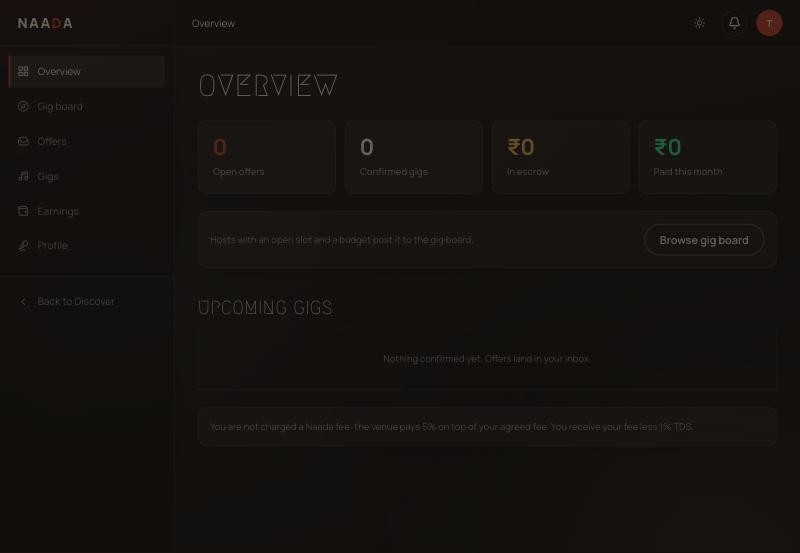
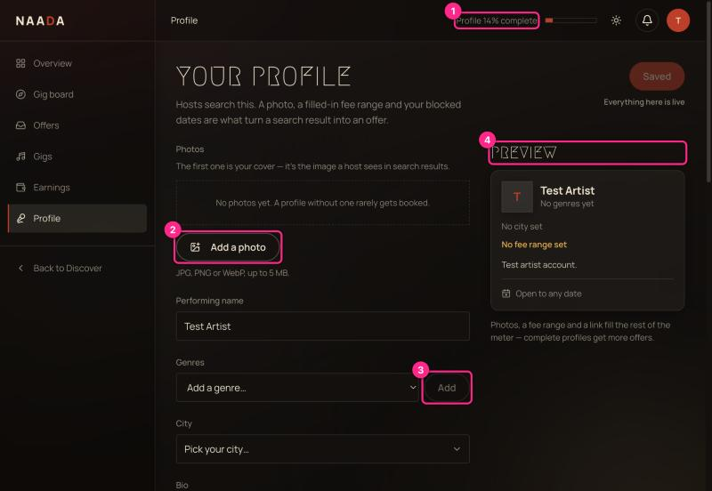
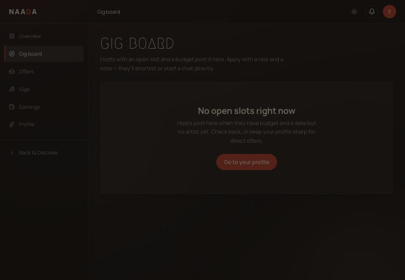

# 08 · Artist: profile, gig board, offers and earnings

**Who:** performers. Choose **I'm an artist** when you sign up ([00](00-getting-started-sign-in-and-roles.md)). You land in the artist console at `/artist`.

## Overview

Four tiles: **Open offers**, **Confirmed gigs**, **In escrow** (money held for you until the gig is confirmed), **Paid this month**. Below: a shortcut to the **Gig board** and your **Upcoming gigs**.

The footer note explains fees: *you are not charged a Naada fee — the venue pays 5% on top of your agreed fee; you receive your fee less 1% TDS.*

> ⚠ The host's Bookings page says Naada's fee is **7%**, not 5% (UX-AUDIT **H7**). Confirm which is right before quoting it to anyone.
>
> ⚠ A new artist sees four zeroes and no "what to do next" (profile is 14% complete but that's only shown on the Profile page — UX-AUDIT **M2**).

## Build your profile first

Sidebar → **Profile**. Hosts search this page; a photo, a fee range and blocked dates are what turn a search result into an offer.

| # | What you're looking at |
|---|---|
| 1 | **Profile % complete** — the meter at the top (14% for an empty profile). It fills as you add photo, genres, city, bio, fee range, links. |
| 2 | **Add a photo** — JPG/PNG/WebP up to 5 MB. The first photo is your cover in search results. |
| 3 | **Genres** — pick from the list, then **Add**. |
| 4 | **Preview** — what hosts see in search. |

Further down:

- **Performing name, City, Bio** (two sentences is plenty).
- **Fee range** — *only hosts see it, in artist search; never on your public page.*
- **Dates you can't play** — block a date and it appears on your public page so people stop asking.
- **Availability note** (280 characters), **Instagram / YouTube / Website**.
- **Business & payouts** — GSTIN, PAN, bank details. Saving sends them for KYC review; nothing is paid until verified.
- **Save changes**.

> ⚠ The button reads **"Saved · Everything here is live"** from the moment the page opens (UX-AUDIT **M12**).

## Gig board

Sidebar → **Gig board**. Hosts post here when they have a date and a budget but no artist.

When there are open slots you apply with a rate and a note; the host shortlists you or starts a chat. An empty board tells you why and offers **Go to your profile**.

## Offers, Gigs and Earnings

| Page | What it shows | Empty state says |
|---|---|---|
| **Offers** | Offers hosts send you; you accept, counter or decline. | *No offers yet — a complete profile with clips gets found more.* → **Finish your profile** |
| **Gigs** | Accepted offers with their fee and escrow status. | *Accept an offer and it moves here.* → **See your offers** |
| **Earnings** | Per gig: fee, 1% TDS, net, status. | *Nothing earned yet.* |

Money flow in one line: host funds the booking → held in **escrow** → released after the gig is confirmed (or automatically 72 hours after completion) → you get fee minus 1% TDS.

## Chat safety

Messages are screened for phone numbers, emails, UPI IDs and handles. Flagged messages are still delivered, but a Naada admin can review them ([09](09-admin-guide.md)). Keep bookings and payments on Naada so escrow protects you.
