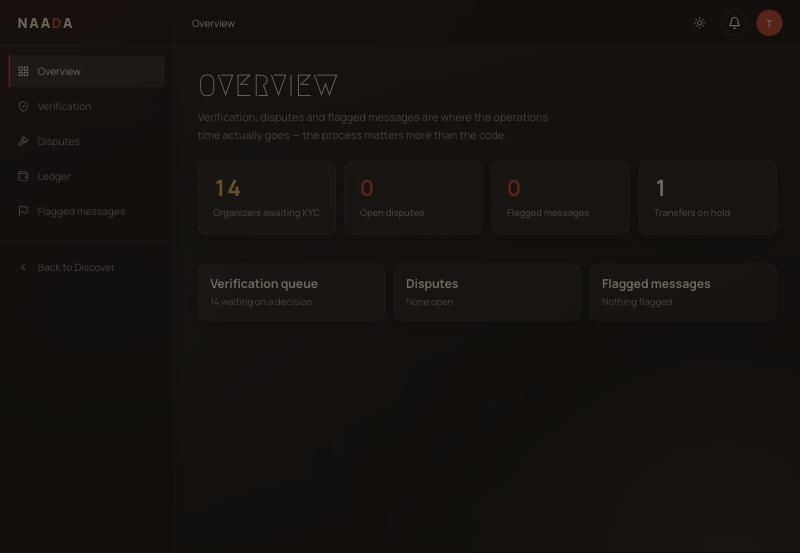
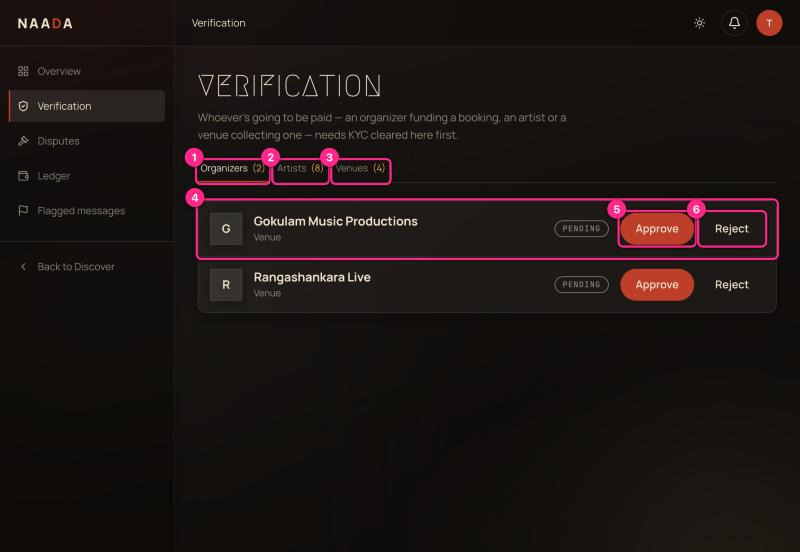
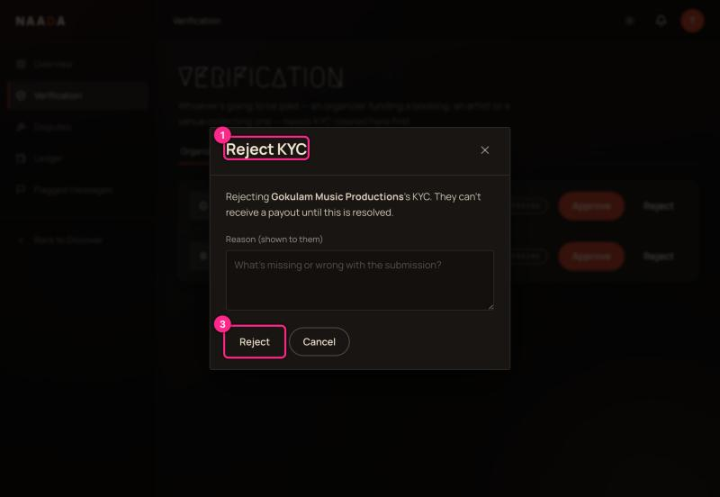

# 09 · Admin: verification and operations

**Who:** Naada staff with an admin account (`/admin`).

## Overview

Tiles: **Organizers awaiting KYC**, **Open disputes**, **Flagged messages**, **Transfers on hold**. The three cards below link to the queues.

> ⚠ The intro line on this page is internal wording ("the process matters more than the code") — replace it before launch (UX-AUDIT **M8**).

## Verify who gets paid (KYC)

Sidebar → **Verification**. Anyone who will be paid — an organizer funding a booking, an artist or a venue — must be cleared here first.

| # | What you're looking at |
|---|---|
| 1 | **Organizers** tab (count of pending). |
| 2 | **Artists** tab. |
| 3 | **Venues** tab. |
| 4 | **A submission** — name and type. |
| 5 | **Approve** — they can now receive payouts. |
| 6 | **Reject** — asks for a reason that is shown to them. |

### Rejecting

| # | What you're looking at |
|---|---|
| 1 | **Reject KYC** — names who and says what happens ("they can't receive a payout until this is resolved"). |
| 3 | **Reject** — sends the reason. (**Cancel** is next to it.) |

Write a specific reason ("PAN doesn't match account holder name") — the host or artist sees it word-for-word.

> ⚠ **Heads-up for reviewers:** each row shows only a name and a PENDING pill. **You cannot see the PAN, GSTIN, bank last-4 or any document before you approve** (UX-AUDIT **H4**). Until that's added, check submissions in the Django admin before clicking Approve.

## Disputes

Sidebar → **Disputes**. Funds stay in escrow until a dispute is resolved here — the auto-release timer never fires on a disputed booking. Shows **OPEN** disputes (none in the test data).

## Ledger

Sidebar → **Ledger**. Every money movement on a **host ↔ artist booking**: gross charge, platform fee, TDS, artist payout, refunds, reversals. Filter by type.

> Ticket-sale revenue **isn't** on the ledger yet, so it isn't shown rather than guessed (the page says so). That also means hosts can't see their ticket payouts (UX-AUDIT **H3**).

## Flagged messages

Sidebar → **Flagged messages**. Chat messages that contained phone numbers, emails, UPI IDs or handles. Flagging never blocks a message — it just lands here for review.

## What admins can't see (yet)

- Which gatekeepers are scanning which events (hosts see this for their own events; there is no platform-wide view).
- A list of all events, users or venues with search.
- Venue photos, address or description.
