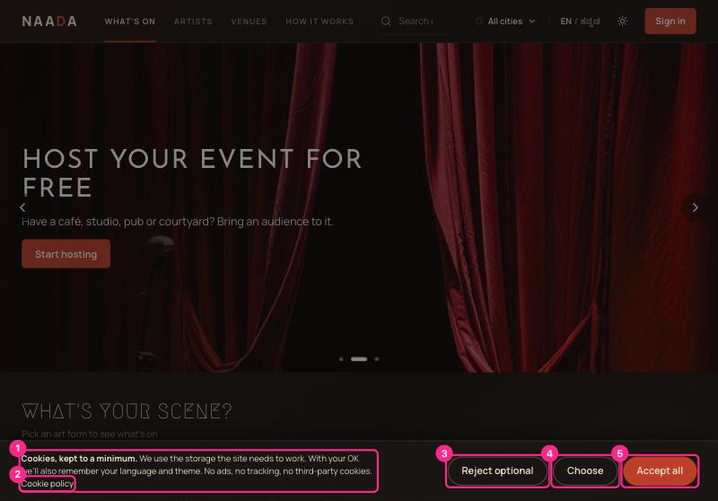
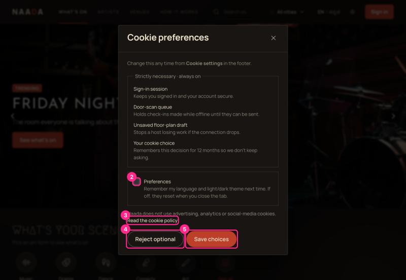
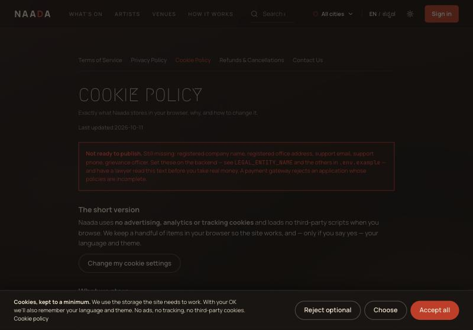
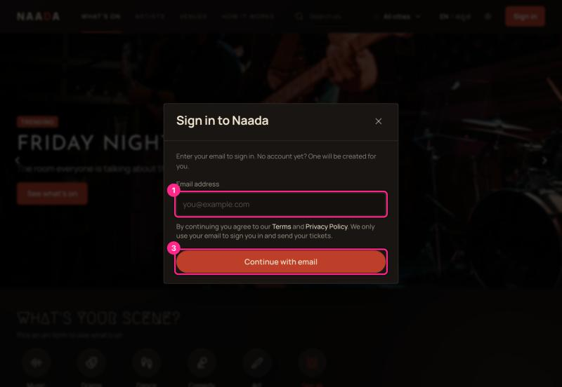
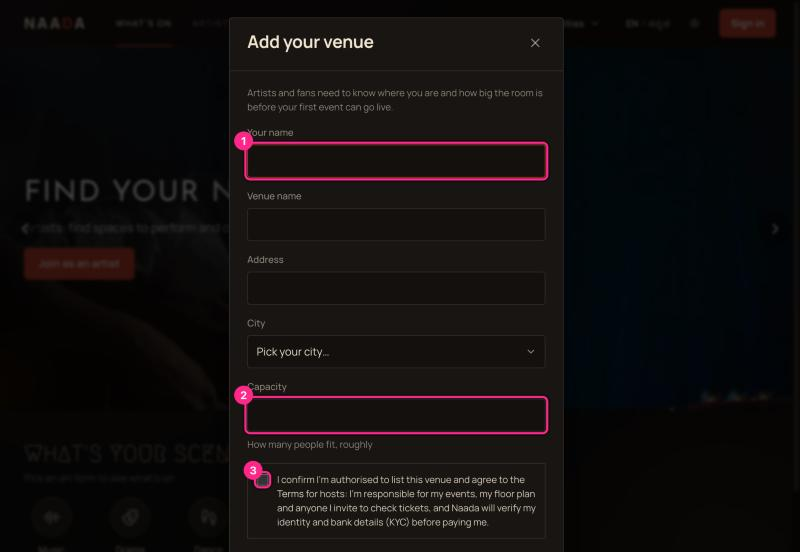
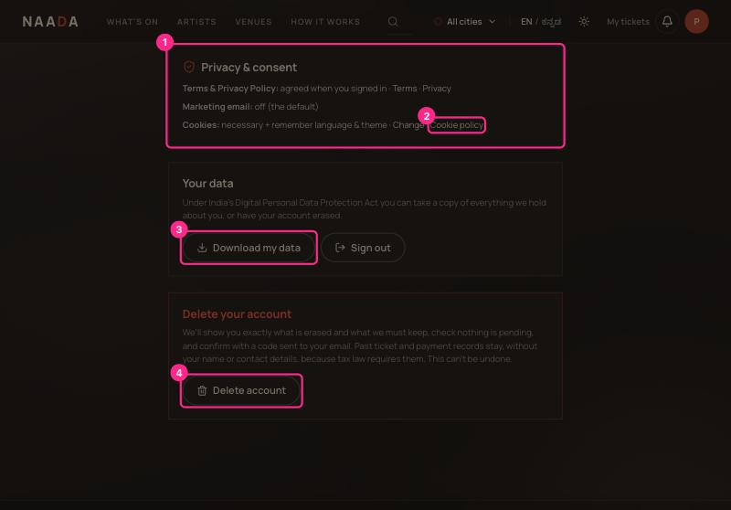
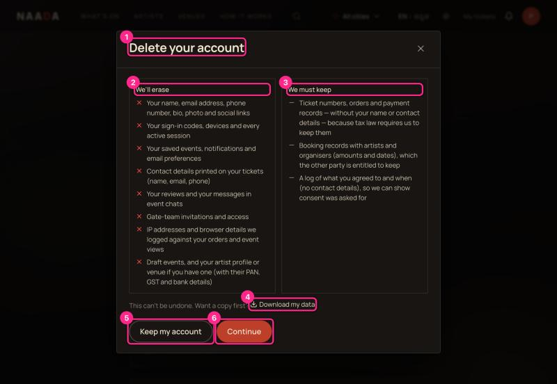
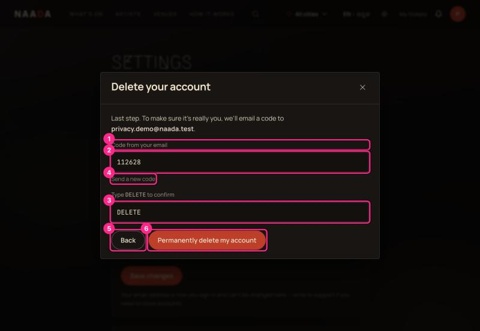
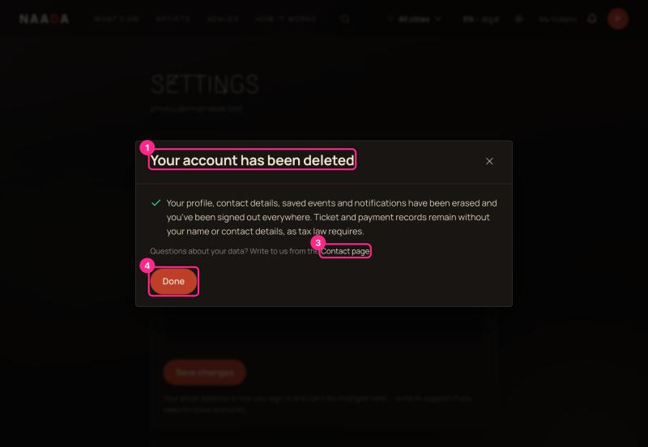

# 10 · Privacy, cookies, consent and deleting your account

**Who:** everyone. What Naada asks you to agree to, how to change your mind, how to get a copy of your data, and how to delete your account.

The full legal documents are always one click away in the page footer: **Terms · Privacy · Refunds · Cookies · Contact**.

## 1 · The cookie notice

The first time you visit, a notice appears at the bottom of the screen.

| # | What you're looking at |
|---|---|
| 1 | **The notice** — says what is stored: only what the site needs, plus (if you agree) your language and theme. No ads, no tracking, no third-party cookies. |
| 2 | **Cookie policy** — the full list of everything stored. |
| 3 | **Reject optional** — keep only what the site needs. Same size and weight as Accept: no dark patterns. |
| 4 | **Choose** — decide item by item. |
| 5 | **Accept all** |

You can ignore the notice and keep browsing: nothing optional is stored until you say yes. The notice never appears over the door scanner.

### Choosing

| # | What you're looking at |
|---|---|
| 2 | **Preferences** — *remember my language and theme next time.* Off by default. If left off, they reset when you close the tab. |
| 3 | **Read the cookie policy** |
| 4 | **Reject optional** |
| 5 | **Save choices** |

The box above number 2 lists what is **always on** and why (sign-in session, door-scan queue, unsaved floor-plan draft, your cookie choice). These can't be switched off in Naada, because the site wouldn't work without them.

> **Change your mind any time:** page footer → **Cookie settings** (or Settings → Privacy & consent → **Change**). Choosing *Reject optional* later removes the remembered language and theme.

### The Cookie Policy page

It lists every item Naada stores — name, where, purpose, category and how long it lasts — and explains the only third-party code (the payment window, loaded only when you press **Pay**). Fonts and images are served by Naada itself, so visiting doesn't send your address to a font provider.

> The red **"Not ready to publish"** bar you may see at the top of the legal pages in a test build means the company name, address and grievance officer haven't been set yet. It disappears once the operator fills them in ([compliance/README.md](../compliance/README.md)).

## 2 · What you agree to when you sign in

Under the email box: *"By continuing you agree to our Terms and Privacy Policy. We only use your email to sign you in and send your tickets."* Both links open in a new tab, so reading them never loses what you typed. Your agreement is recorded with the date and the version of the documents.

### Hosts and artists agree to more

When you choose **I host events** (or **I'm an artist**), a **required, unticked** box asks you to confirm you're authorised to list the venue and to accept the hosts' (or artists') terms — including that Naada checks your identity and bank details before paying you. **Finish setting up** stays disabled until you tick it.

### Buying a ticket

- **Guest checkout** asks you to agree that Naada stores your details to issue your ticket **and shares your name and contact details with the organiser** so they can admit you and reach you if the event changes.
- **Signed-in buyers** see a line on the payment page: paying means you agree to the Terms and Refund policy, and the organiser sees your name and ticket details.

### When someone else types your details

- A **host inviting a gatekeeper** enters your email or phone. It is used only to match the invitation to your account, and is **erased if you decline or the host cancels**.
- A friend **transferring you a ticket** enters your email only to find your account.

## 3 · Your privacy controls

Settings → **Privacy & consent**.

| # | What you're looking at |
|---|---|
| 1 | **The summary** — which version of Terms and Privacy you agreed to and when; whether marketing email is on (off by default); your cookie choice with a **Change** link. |
| 2 | **Cookie policy** link. |
| 3 | **Download my data** — a JSON file of everything we hold about you: profile, tickets (with the details printed on them), orders, saved events, reviews, notifications, gate duty, artist or venue records, devices, email preferences and your consent history. |
| 4 | **Delete account** — starts the guided process below. |

**Correct your data:** edit your name, phone and bio under *Your details* in the same page. Anything else — write to us from the Contact page.

**Withdraw marketing consent:** switch off *What's on in your city* under *Email notifications*. The change is recorded.

## 4 · Deleting your account

Settings → **Delete account**. It takes three short steps, and nothing is erased until the last one.

### Step 1 — Review

| # | What you're looking at |
|---|---|
| 1 | **Delete your account** |
| 2 | **We'll erase** — your name, email, phone, bio and photo; sign-in codes, devices and every session; saved events, notifications and email preferences; the contact details printed on your tickets; your reviews and event-chat messages; gate-team invitations; IP addresses and browser details logged against your orders and views; draft events, and an artist profile or venue if you have one (including PAN, GST and bank details). |
| 3 | **We must keep** — ticket numbers, orders and payment records (without your name or contact details) because tax law requires it; booking records that other people are entitled to keep; and a log of what you agreed to, with no contact details. |
| 4 | **Download my data** — take a copy first. |
| 5 | **Keep my account** — leave without changing anything. |
| 6 | **Continue** |

The review checks your account **live** and may show two kinds of notice above those columns:

- 🔴 **Things that stop you deleting** — an **upcoming live event** you organise (guests may hold tickets: cancel it or wait for it to end), or a **booking in progress** with money in escrow. **Continue** is disabled and each notice links to where you can sort it out.
- 🟠 **Things you'd lose** — **tickets to upcoming events**. They are not refunded if you delete. You must tick *"I understand I'll lose access to these tickets and they won't be refunded"* to go on. (Cancel or transfer them first if you want your money or seat back.)

### Step 2 — Confirm it's you

| # | What you're looking at |
|---|---|
| 1–2 | **Code from your email** — press **Email me a code**; a fresh six-digit code is sent to your address and expires in 10 minutes. (In a test build the code is filled in for you.) |
| 3 | **Type DELETE** — a second, deliberate confirmation. |
| 4 | **Send a new code** |
| 5 | **Back** — return to the review. |
| 6 | **Permanently delete my account** — enabled only when you have both a code and the word DELETE. |

> Why the code? So a stolen phone or a browser someone left signed in can't wipe your account.

### Step 3 — Done

The confirmation says what happened: your profile, contact details, saved events and notifications are erased, you're signed out everywhere, and ticket and payment records remain without your name or contact details. **Done** returns you to the home page, signed out. You can sign up again later with the same email; it starts a brand-new, empty account.

> If something changed while you were deciding (for example you just made a booking), the flow takes you back to the review and shows the new blocker. Nothing is deleted without a successful final step.

## 5 · If you can't use the app

Write to the support email on the **Contact** page. Say which right you want (a copy, a correction, erasure, or to withdraw consent). Complaints go to the **grievance officer** named there; the policy says we acknowledge within 48 hours and aim to resolve within 30 days.
